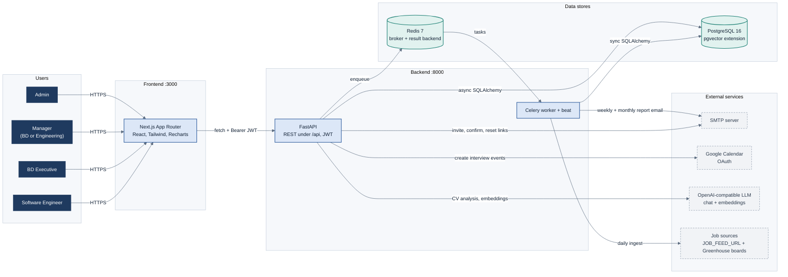
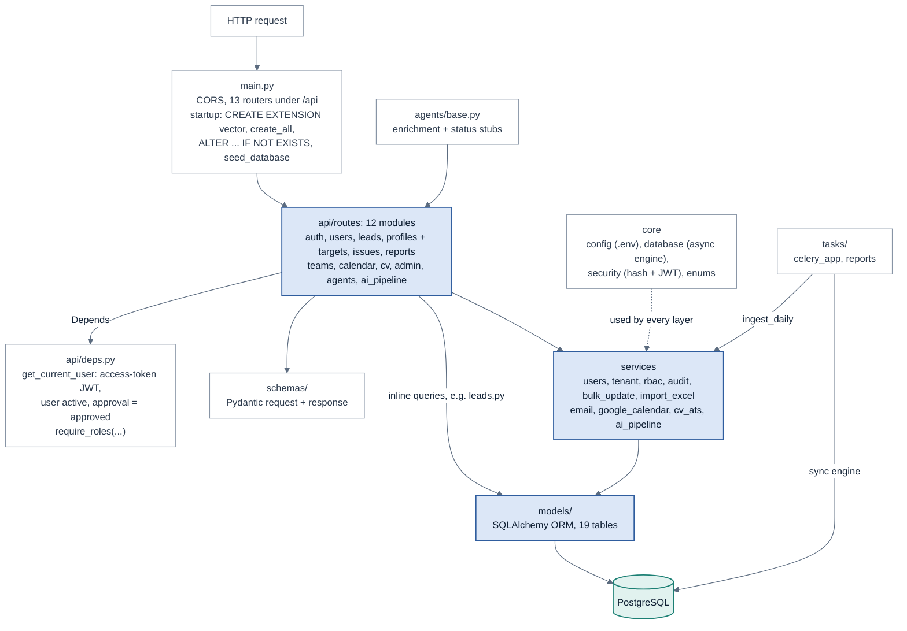
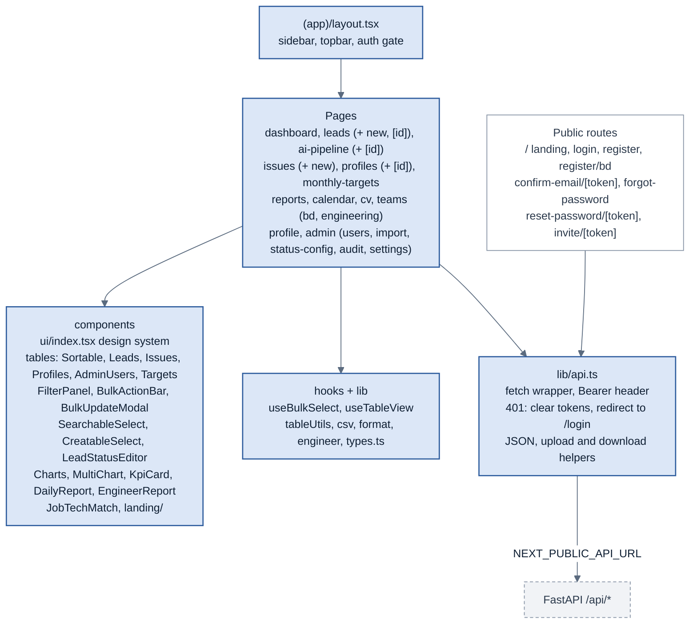
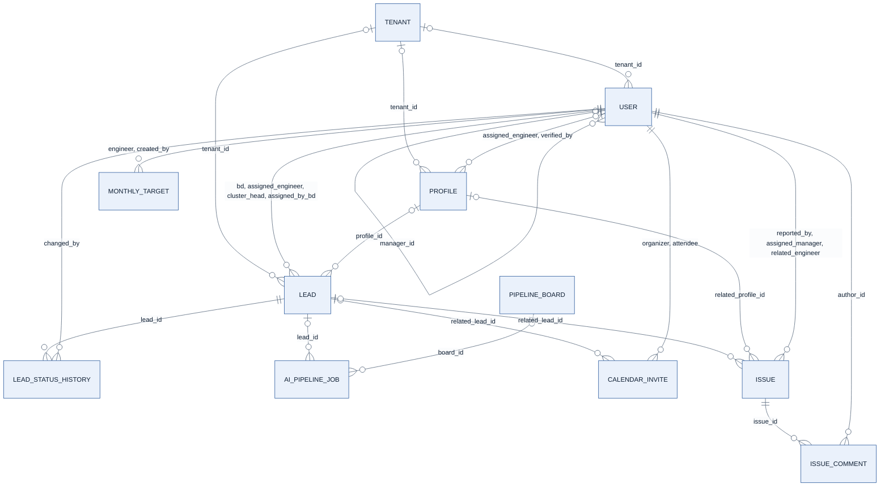
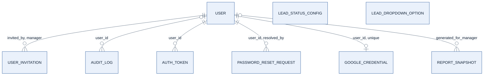
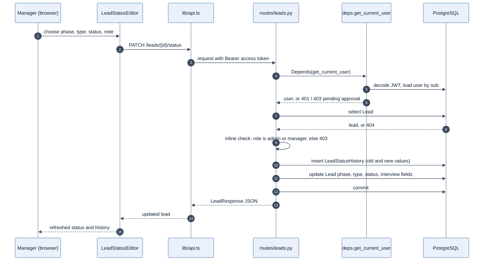
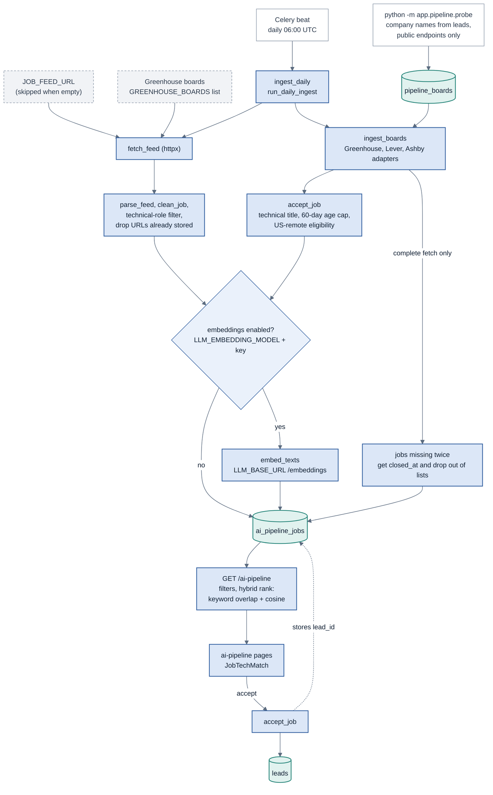
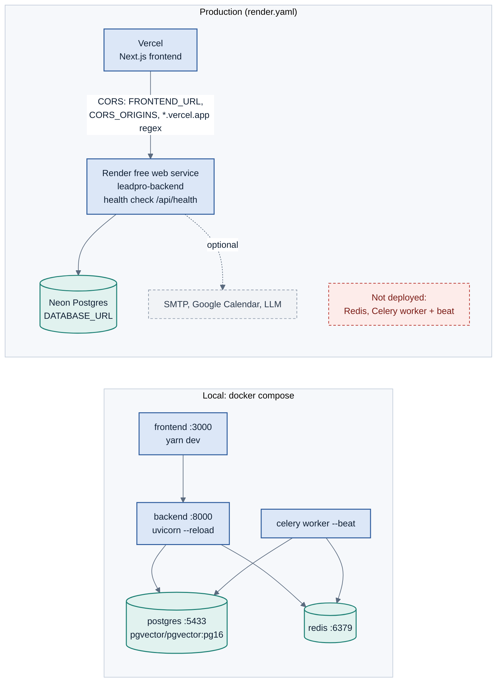

# LeadPro Architecture

A multi-role lead and recruitment pipeline. A Next.js app calls a FastAPI backend over JSON, Postgres holds the data, and Celery with Redis runs scheduled reports and the daily AI job ingest.

**Stack:** Next.js 15, TypeScript, Tailwind, Recharts, FastAPI, SQLAlchemy (async), Postgres 16 + pgvector, Celery, Redis 7.

Diagrams are Mermaid and render on GitHub, GitLab and most Markdown viewers. A PDF copy with the diagrams pre-rendered is in [`architecture.pdf`](architecture.pdf).

Contents: [System](#1-system-context) · [Backend layers](#2-backend-layers) · [Modules](#3-domain-modules) · [Frontend](#4-frontend) · [Data model](#5-data-model) · [Request flow](#6-request-flow) · [AI pipeline](#7-ai-pipeline) · [Roles](#8-roles-and-permissions) · [Deployment](#9-deployment) · [Suggestions](#10-suggestions)

## 1. System context

Four kinds of users reach one web app. The browser only calls the FastAPI API. Email, calendar, LLM and job-feed access are made by the backend.

## 2. Backend layers

Guards sit in front of the routes. Shared logic lives in services, but several routes also query the ORM directly.

## 3. Domain modules

Each feature is a slice: a route file, a schema file and usually a model, with shared logic in services.

| Module | Files | What it does |
|---|---|---|
| Auth and onboarding | `routes/auth.py`, `routes/users.py` | Login, refresh, self-register with email confirm or admin approval, invites, forgot and reset password |
| Leads | `routes/leads.py`, `models/lead.py` | CRUD, multi-field search, status change with history, CSV export, dropdown options, status config |
| AI Pipeline | `routes/ai_pipeline.py`, `services/ai_pipeline.py`, `pipeline/` | Daily job ingest from feeds and company boards (Greenhouse, Lever, Ashby), US-remote eligibility, closing of vanished jobs, filtering and ranking, tech share, engineer suggestions, accept a job as a lead |
| Profiles and targets | `routes/profiles.py`, `models/profile.py` | Candidate registry and monthly engineer quotas |
| Issues | `routes/issues.py`, `models/issue.py` | Log, triage, comment, bulk update |
| Reports | `routes/reports.py`, `tasks/reports.py` | Dashboard, weekly, monthly, per-BD daily, engineer funnel, scheduled email |
| Teams and import | `routes/teams.py`, `services/import_excel.py` | Engineering and BD team lists, Excel import and templates |
| Calendar | `routes/calendar.py`, `services/google_calendar.py` | Google OAuth connect, interview invites tied to a lead |
| CV Optimizer and agents | `routes/cv.py`, `services/cv_ats.py`, `routes/agents.py` | ATS analysis through the LLM. The two agents are stubs |
| Admin and audit | `routes/admin.py`, `services/audit.py` | Status config, audit log, Excel import and template |

## 4. Frontend

Pages in the signed-in `(app)` group share one shell. Every page reaches the backend through `lib/api.ts`.

## 5. Data model

Relationships follow the foreign keys in `backend/app/models`, 19 tables in all. Where one table points at `users` several times, the line lists each column.

Account and operations tables hang off `users` only. The two lookup tables have no foreign keys.

A lead stores its phase, type, status and source as plain values, so nothing in the database enforces that they match `LEAD_STATUS_CONFIG` or `LEAD_DROPDOWN_OPTION`.

## 6. Request flow

Changing a lead's status, as the code does it today. The role check is inline in the route and no audit entry is written.

A 401 anywhere makes `lib/api.ts` clear the stored tokens and send the browser to `/login`. The route does not check the new values against `lead_status_config`.

## 7. AI pipeline

A daily job feeds `ai_pipeline_jobs` from the feed URL and from company boards on Greenhouse, Lever and Ashby. Board jobs are kept only if the title is technical, the posting is at most 60 days old, and the role is remote and open to US candidates (US, US or Canada, worldwide, or a European posting that names the US). A job missing from two complete fetches of its board is closed; a failed or partial fetch never closes anything. People browse and rank the jobs, and accepting one creates a lead.

Seed the board list once with `python -m app.pipeline.probe`. Without an embedding model the jobs are still stored and the page sorts by newest. The ai-pipeline routes allow Admin, Manager and BD.

## 8. Roles and permissions

Taken from `services/rbac.py`, the lead status route, and the role guards on the agents and ai-pipeline routes. A user must also be active and approved before any role applies.

| Capability | Admin | Manager | BD | Engineer |
|---|:-:|:-:|:-:|:-:|
| Manage users | Yes | Yes | No | No |
| Manage monthly targets | Yes | Yes | No | No |
| Manage profiles | Yes | Yes | No | No |
| View all leads | Yes | Yes | No | No |
| Create leads | Yes | Yes | Yes | No |
| Change lead status | Yes | Yes | No | No |
| Triage issues | Yes | Yes | No | No |
| Log issues | Yes | Yes | Yes | Yes |
| AI pipeline (browse, accept) | Yes | Yes | Yes | No |
| Agent: enrich lead | Yes | Yes | Yes | No |
| Agent: suggest status | Yes | Yes | No | Yes |

Managers have a type, `bd_manager` or `engineering_manager`. Accounts are `pending`, `approved` or `rejected`, and only approved accounts get past the guard. Admin routes, reports and calendar were not checked line by line, so they are left out of the table.

## 9. Deployment

Local development runs everything in Docker Compose. The production blueprint covers the API only: Render for the backend, Neon for Postgres, Vercel for the frontend.

The backend `Dockerfile` is written to run on Render, Hugging Face Spaces, Koyeb, Fly.io or Railway and reads `$PORT`. The weekly report, monthly report and daily AI ingest all depend on Celery beat, so none of them run in production as the blueprint stands.

## 10. Suggestions

Ordered by risk. Each one comes from something seen in the code or config.

**High**

1. **Remove default secrets from production paths.** `jwt_secret` defaults to `change-me` and the seeded admin password to `admin123`. Demo accounts are in the README and on the login page, and `seed_database()` runs at every startup. Fail startup when the JWT secret is still the default, and gate the demo seed behind an environment flag.
2. **Fix token storage and the missing refresh flow.** Tokens sit in `localStorage`, which any script injection can read. The refresh token is stored but nothing in `lib/api.ts` uses it, so users are logged out after the 30 minute access token expires. Use httpOnly cookies, or add a silent refresh on 401.
3. **Replace startup DDL with Alembic.** `create_all` plus a list of `ALTER ... IF NOT EXISTS` statements runs on every boot. It cannot change a column or roll back, and two instances starting together race each other. `CREATE EXTENSION vector` is not wrapped, so a database without pgvector stops the whole API from starting. Run migrations as a release step.
4. **Give production a scheduler.** Add a Render background worker and a Redis instance, or call the report and ingest functions from Render cron jobs. Without that the weekly report, monthly report and AI ingest never run.

**Medium**

5. **Enforce status values and write audit entries.** Validate phase, type and status against `lead_status_config` in the status route, or add foreign keys. Call `log_audit` there too, since history rows and the audit log are separate today.
6. **Centralise authorization and tenant scoping.** Role checks are split between `require_roles`, inline checks and `rbac` helpers. `tenant_id` is nullable on users, leads and profiles. Move the rules into one policy module and confirm that every list query filters by tenant (not checked in this review).
7. **Thin the routes and split the big service.** `reports.py` is 623 lines, `leads.py` 565 and `services/ai_pipeline.py` 968. Move queries into services or repositories, and split the pipeline into fetch, clean, rank and accept modules.
8. **Add login protection and a real health check.** Rate-limit login, forgot-password and register. Make `/api/health` check the database (and Redis when present) as a readiness probe, and keep a plain liveness route.

**Low**

9. **Generate the API types.** Use the FastAPI OpenAPI schema to generate `types.ts` and a typed client, so the frontend and backend cannot drift.
10. **Cache the heavy report endpoints.** Redis is already running. Cache dashboard and engineer-funnel responses for a short time, and add pagination limits to the long resource reports.
11. **Repository hygiene.** The backend folder holds `venv`, `build`, `celerybeat-schedule` and an egg-info folder, and the root has `.venv` and `node_modules`. Make sure all of them are git-ignored.
12. **Features worth adding.** In-app and email notifications for assignments and status changes; a lead activity timeline that merges history, issues and calendar invites; duplicate-lead detection; an engineer to job match score on the AI pipeline using the embeddings already stored; and wiring the two agent stubs to the LLM.
